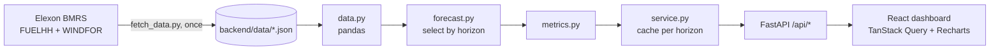

# Windsight

A web app for a UK energy supplier's day-ahead buying team. It shows the wind generation forecast that was available when power had to be bought, compares it with what the wind actually produced, and measures how far the forecast can be trusted.

- Live app: https://windsight-gold.vercel.app
- API docs (Swagger): https://windsight-gold.vercel.app/api/docs

Scope: Great Britain national wind generation for January 2026, using Elexon BMRS data only (actuals from `FUELHH`, forecasts from `WINDFOR`).

## What the app answers

1. What did the latest forecast say at the time of buying? Pick a delivery period and a forecast horizon (0 to 48 hours). For every delivery hour, the app uses the latest forecast published at least that many hours earlier, and plots it against the actual output.
2. How wrong is that forecast, and in which direction? The app reports the typical miss (MAE), RMSE, bias, the 90th percentile miss, how error grows with lead time, error by hour of day, and how much wind could be relied on (P10 of actual output).

Main findings for January 2026 at a 24 hour (day-ahead) horizon:

| Measure | Value |
|---|---|
| Typical miss (MAE) | 2.05 GW, 17.7% of average output |
| Bias (forecast minus actual) | +1.85 GW: the forecast was too high in 86.8% of hours |
| Typical miss after removing the bias | 1.32 GW |
| Out-of-sample bias correction (learn on 1-15 Jan, apply to 16-31 Jan) | 2.02 GW down to 1.04 GW (-48%) |
| 90% of hours missed by less than | 4.13 GW |
| Wind output exceeded 90% of the time (P10) | 5.62 GW |
| Hardest delivery hour | 05:00-06:00 (2.51 GW typical miss) |
| Easiest delivery hour | 16:00-17:00 (1.68 GW) |
| Typical miss, freshest forecast vs 48 h ahead | 1.79 GW vs 2.38 GW |

A likely cause of the steady over-forecast is curtailment: wind farms paid to switch off reduce metered output, while the forecast shows what the wind could have produced. Elexon's wind data alone cannot confirm this.

## Running it

### With Docker (simplest)

```bash
docker compose up --build
```

Open http://localhost:8080. The API is served through the same address at `/api` (docs at http://localhost:8080/api/docs). Stop with `docker compose down`.

### Without Docker

Requirements: Python 3.12, Node 22 or later, pnpm 11 (`corepack enable` provides it).

Backend (terminal 1):

```bash
cd backend
python3.12 -m venv .venv && source .venv/bin/activate
pip install -r requirements-dev.txt
uvicorn app.main:app --reload          # http://localhost:8000/api/docs
```

Frontend (terminal 2):

```bash
cd frontend
pnpm install
pnpm dev                               # http://localhost:5174, proxies /api to port 8000
```

### Tests and checks

```bash
cd backend
pytest                                 # 23 tests: selection logic, metrics, API
ruff check . && ruff format --check .

cd ../frontend
pnpm type-check && pnpm lint && pnpm build
```

### Refreshing the data

The app never calls Elexon at request time. It serves two JSON files cached in `backend/data/`. To download them again:

```bash
python backend/scripts/fetch_data.py   # standard library only
python backend/scripts/bias_check.py   # out-of-sample bias correction table (needs the backend venv)
```

## Repository layout

```
.
├── api/index.py              Vercel entry point; imports the FastAPI app from backend/
├── backend/
│   ├── app/
│   │   ├── config.py         Data window, horizon limits, paths
│   │   ├── data.py           Loads the cached JSON into pandas, once per process
│   │   ├── forecast.py       Core logic: latest forecast published at least H hours before each target
│   │   ├── metrics.py        Error statistics (MAE, RMSE, bias, quantiles, error by hour)
│   │   ├── service.py        Joins data and logic for the API, caches per horizon
│   │   ├── schemas.py        Pydantic response models (camelCase JSON)
│   │   └── main.py           FastAPI routes and input validation
│   ├── data/                 Cached Elexon data: actuals.json, forecasts.json
│   ├── scripts/
│   │   ├── fetch_data.py     Downloads and filters January 2026 data from Elexon
│   │   └── bias_check.py     Out-of-sample test of a bias correction
│   ├── tests/                pytest suite
│   ├── Dockerfile
│   └── requirements.txt      (requirements-dev.txt adds pytest, httpx, ruff)
├── frontend/
│   ├── src/
│   │   ├── api/wind/         API calls, query keys and TanStack Query hooks
│   │   ├── components/       shadcn/ui primitives and shared components
│   │   ├── hooks/            Debounce, theme, reduced motion, animated numbers, scroll state
│   │   ├── lib/              Formatting (GW, dates in UK time), CSV export
│   │   ├── pages/dashboard/  The dashboard page, its components and chart helpers
│   │   ├── request/          Axios instance with error toasts
│   │   └── types/            TypeScript types matching the API schemas
│   ├── Dockerfile            Builds with pnpm, serves with nginx
│   └── nginx.conf            Serves the app and proxies /api to the backend container
├── docker-compose.yml
├── vercel.json               Vercel build, function and routing config
└── requirements.txt          Python dependencies for the Vercel function
```

## How it works



### Data

| Dataset | Use | Resolution | Rows kept |
|---|---|---|---|
| `FUELHH`, fuel type `WIND` | Actual generation | Half-hourly | 1,488 slots, none missing |
| `WINDFOR` | Forecast generation | Hourly, about 8 forecast runs a day | 14,383 rows from 264 runs |

Target (delivery) times run from 1 January 00:00 to 31 January 23:30 UTC. The UK is on GMT in January, so UTC is local time. Forecasts are kept if they were published 0 to 72 hours before their target time. The horizon slider stops at 48 hours, but a forecast picked for a 48 hour horizon was published more than 48 hours ahead, so the cache needs the longer window.

### Picking the forecast for a horizon

For each target time `T` and horizon `H`, the app keeps forecasts for `T` published at or before `T - H` and takes the most recent one (`backend/app/forecast.py`). Target hours with no such forecast are left out. This happens near 48 hours: each forecast run only reaches the end of the day after tomorrow, so at 48 hours 589 of the 744 hours have a forecast.

### Comparing with actuals

Forecasts are hourly and actuals are half-hourly, so errors are computed on the hour only. The chart still draws actuals at half-hour resolution. Error is forecast minus actual, so a positive bias means the forecast promised more wind than arrived.

### API

All routes take optional `start` and `end` (ISO 8601, inside January 2026, inclusive) and, where relevant, `horizon` (whole hours, 0 to 48, default 24). Invalid input returns 422.

| Route | Returns |
|---|---|
| `GET /api/health` | Status |
| `GET /api/meta` | Data window, horizon limits, row and run counts |
| `GET /api/series` | Half-hourly actuals with the selected hourly forecast and its publish time |
| `GET /api/metrics` | MAE, RMSE, bias, median and P90 absolute error, error P10/P90, share of over-forecast hours, MAE after bias removal, P10 of actual output |
| `GET /api/horizon-curve` | MAE, RMSE and bias for every horizon from 0 to 48 hours |
| `GET /api/error-by-hour` | MAE and bias for each delivery hour of the day |

### Frontend

One page with a shared filter bar (delivery period and horizon). Every number on the page comes from the same filtered slice, so they always agree. Changing a filter keeps the previous data on screen, dimmed, until the new data arrives. The slider is debounced by 200 ms. Each analysis chart has a table view, and the main chart has a CSV download.

## Deployment

The app runs as one Vercel project, deployed from GitHub on every push to `main`:

- The Vite build is served as static files from `frontend/dist`.
- `/api/*` is rewritten to one Python function, `api/index.py`, which imports the same FastAPI app used locally and in Docker.
- Other paths fall back to `index.html`.

Docker is for running locally; Vercel does not run containers.

## Development practices

- Small, pure functions for the core logic, kept apart from data loading and the web layer. They are tested with hand-made inputs whose answers are known.
- API tests run against the real cached data to catch integration problems.
- Typed end to end: Pydantic models on the backend and matching TypeScript types on the frontend.
- Lint and format: Ruff (Python), ESLint and Prettier (TypeScript). Husky and lint-staged run them on commit, and commitlint enforces Conventional Commits.
- Accessibility: keyboard focus on every control, table views for charts, colour-blind safe series colours (checked with a palette validator), and no motion when the system asks for reduced motion.

## Assumptions and limits

- "Decisions made in January 2026" is read as delivery times in January 2026.
- Delivery periods are whole days, in UK time.
- Missing forecasts are skipped, not filled in.
- The data is a fixed historical month, cached in the repository. A live version would schedule `fetch_data.py` and store results in a database.

## Use of AI tools

As the brief allows, I used Claude Code (Anthropic's coding assistant) as a pair programmer, mainly to speed up writing code, tests, configuration and documentation drafts.

The direction and decisions were mine. I had the work done in phases (data, backend, frontend, analysis, Docker, deployment) and agreed the plan before each one. I made the main calls along the way:

- Cache one month of Elexon data instead of calling the API live
- Serve the frontend and API from a single Vercel project
- Choose the dashboard layout, visual style and name

I reviewed the app after every phase and sent back changes where it fell short. For example, I asked for a redesign of the filters and header, and a cleanup of wording that read as machine-written.
